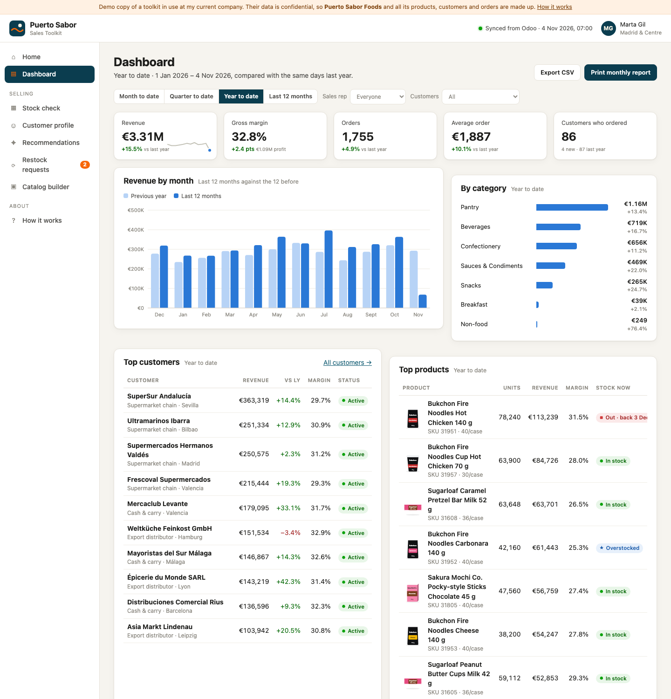
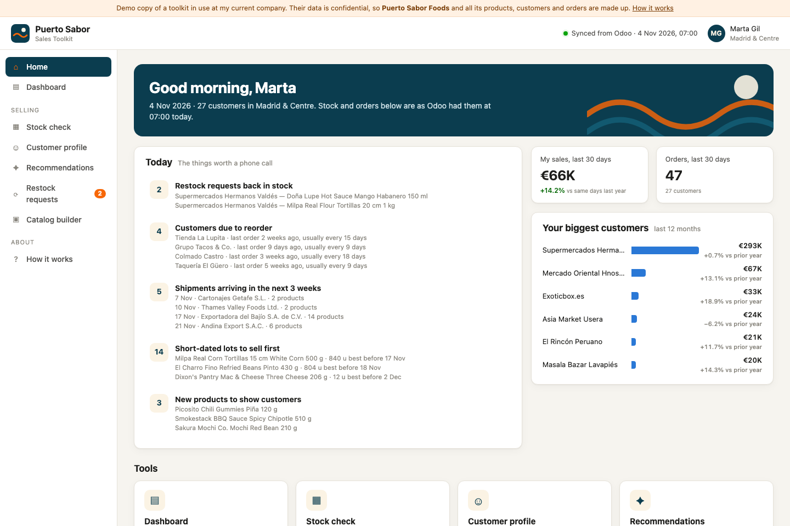
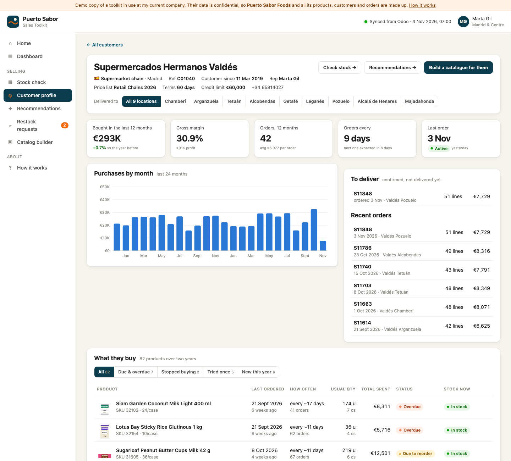
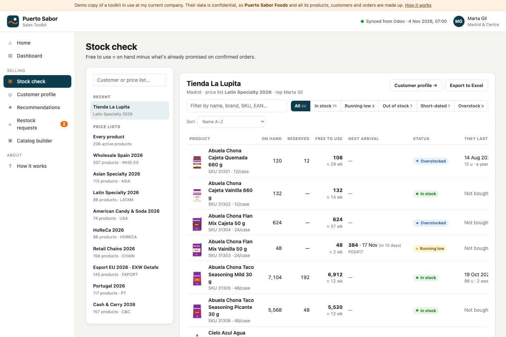
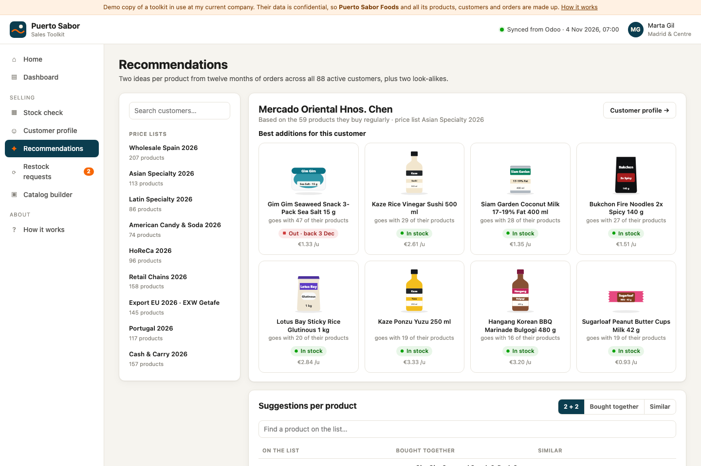
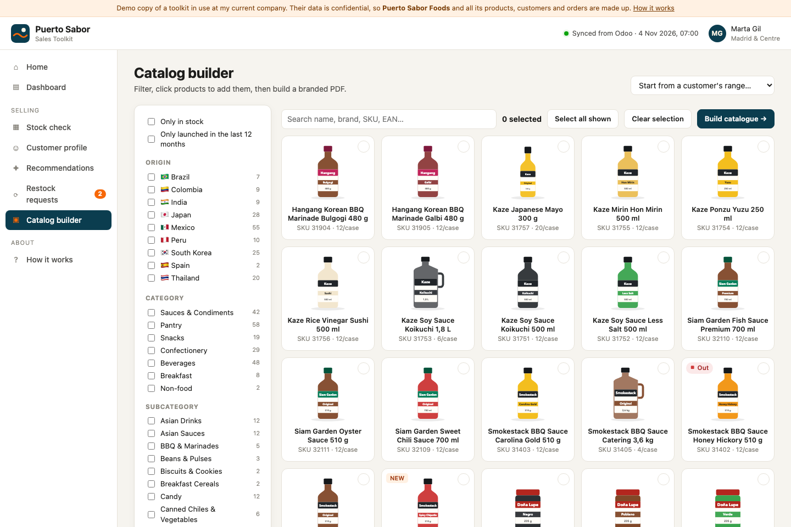
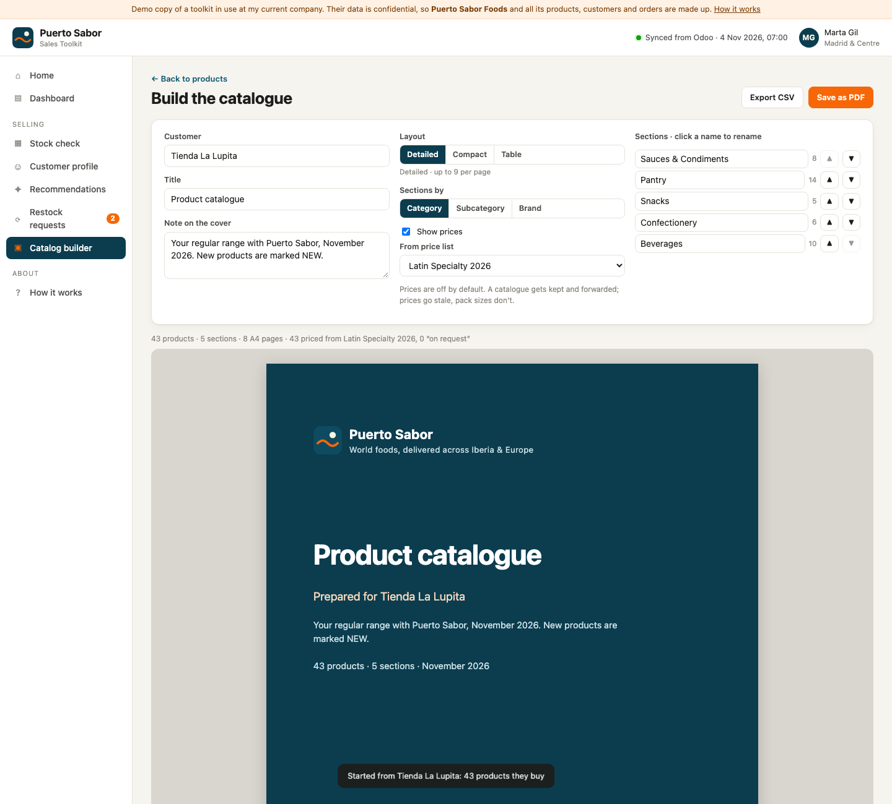

# Odoo Sales Toolkit: catalogue builder, stock check and sales dashboard

A web toolkit that puts a distributor's Odoo data in front of the people who sell:
**live stock per customer, customer profiles, "what to offer next", restock alerts,
a management dashboard and a branded PDF catalogue builder.**

> **About this demo:** I built the full working version of these tools for the company
> I currently work at, running on the company's live Odoo data. That data is confidential,
> so I can't share it. For this public copy I rebuilt the tools on made-up data: a fictional
> company, **Puerto Sabor Foods S.L.**, with a simulated Odoo database built to behave like
> the real thing. Every product, brand,
> customer, price and order here is generated. Barcodes are in the GS1 in-store range,
> so none can match a real product.



**Live demo:** https://sofiasanjose.github.io/odoo-sales-toolkit-demo/

**Sample outputs:** [Catalogue PDF for one shop, with prices](docs/sample-catalogue-la-lupita.pdf) ·
[Catalogue PDF, table layout for a supermarket chain](docs/sample-catalogue-valdes-table.pdf) ·
[Printed monthly sales report](docs/sample-monthly-report.pdf)

---

## The problem it solves

A wholesale food distributor runs on Odoo. The answers the sales team needs every day
are all in there, but scattered across Sales, Inventory and Purchase screens built for
back-office staff:

- *"Can I promise this customer their usual order this week? If not, when does the container land?"*
- *"I'm visiting this shop tomorrow. What do they buy, what's overdue, what did they quietly stop buying?"*
- *"Send me a catalogue of everything they could stock."* (Before: an afternoon in PowerPoint.)
- *"Are we growing? At what margin? Which big customers have gone quiet? How much cash is sitting in stock?"*

The toolkit answers each one on a single screen, in plain language, from the same Odoo data.

## The tools

| Tool | What it answers | Highlights |
|---|---|---|
| **Home** | What should I do this morning? | Restock requests back in stock, customers due to reorder, containers arriving, short-dated lots, new launches |
| **Dashboard** | How is the business doing? | Revenue, gross margin, orders, average order, active customers vs the same days last year · revenue by month vs prior year · categories · top customers and products · **stock health** (out-of-stock sellers, cash in overstock, short-dated value) · **customers at risk** · filters by period, rep and customer type · **prints as a monthly report** · CSV export |
| **Stock check** | Can I promise this order? | Pick a price list or a customer: on hand, reserved, **free to use**, weeks of cover, next arrival with PO and ETA, lots and best-before dates, "they last bought" · Excel export |
| **Customer profile** | Who is this customer? | 12-month spend and margin, ordering rhythm and next expected order, purchases by month, per-delivery-address view for chains, **what they buy** with status (Regular / Due / Overdue / Stopped / Tried once / New), open orders, **similar shops also buy** |
| **Recommendations** | What do I offer next? | Market-basket analysis over 12 months of orders: "62% of buyers of X also buy Y, 2.4× more than usual", plus look-alikes. Never suggests another size of something they already stock |
| **Restock requests** | Who's waiting for what? | Note a customer's request; it lights up (menu badge, Home) when stock is free to sell |
| **Catalog builder** | Make me a catalogue | Filter by origin / category / subcategory / brand, or **start from a customer's own range** · cover, sections, 3 layouts (cards or order-form table) · optional prices from that customer's price list · rename and reorder sections · **A4 PDF** in two minutes · recent catalogues kept |

| | |
|---|---|
|  |  |
|  |  |
|  |  |

## How it works

```
 Odoo (Sales · Inventory · Purchase)
        │  XML-RPC, read-only API user
        ▼
 tools/odoo_sync.py        nightly + on demand
        │  products, packaging, price lists, customers,
        │  sales orders, stock quants + lots, open purchase orders
        ▼
 data/demo-data.js         one snapshot file, time-stamped
        ▼
 index.html + assets/      plain HTML/CSS/JS, no framework, no build step
        ▼
 PDFs · Excel/CSV · alerts
```

- **Odoo stays the single source of truth.** The toolkit only reads, so it cannot break the ERP.
- **No server needed to use it.** It is a static site: host it anywhere (GitHub Pages, Azure Static Web Apps, an intranet), open it on a laptop or phone.
- **No dependencies.** Charts, product drawings and PDF layout are hand-written SVG/CSS. Nothing to install, nothing to keep patched.
- **Analytics run in the browser.** ~87,000 order lines are indexed on load in well under a second; every filter is instant.

### The data contract

`tools/generate_demo_data.py` (simulation) and `tools/odoo_sync.py` (real Odoo) write the
**same file shape**, checked by `odoo_sync.py --check`:

| Key | From Odoo |
|---|---|
| `products` | `product.product` + `product.packaging` (units per case, cases per pallet, case EAN) + sale taxes |
| `pricelists` | `product.pricelist` + fixed-price `product.pricelist.item` rows |
| `customers` | `res.partner` (companies with `customer_rank > 0`), salesperson, price list, payment terms, delivery addresses |
| `orders`, `lines` | confirmed `sale.order` / `sale.order.line`, last 24 months; delivered vs still to deliver |
| `stock` | `stock.quant` in internal locations, `stock.lot` best-before dates, reservations |
| `purchases` | open `purchase.order.line` (ordered − received) with planned dates |

Company-specific field names (brand, origin, which packaging is "the case") sit in one
`FIELD_MAP` at the top of the connector.

### How realistic is the demo data?

`generate_demo_data.py` simulates a Spanish specialty-food importer (~€3.5M a year):

- **208 products** from 10 origin countries under 34 invented brands, each with size, pack type, units per case, cases per pallet, case weight, unit and case EAN, landed cost, list price, Spanish VAT rate (4% / 10% / 21% for sugary drinks) and shelf life.
- **91 customers** of 11 kinds: supermarket chains with up to 9 delivery points, cash & carry, Asian and Latin specialty shops, candy stores, restaurants, online shops, export distributors in DE/FR/NL/BE, Portuguese shops. Each has a rep, a price list, payment terms and a credit limit.
- **~4,000 sales orders and ~87,000 order lines over two years.** Each customer has a core basket that drifts (they try new launches, drop products, a few stop ordering). Complementary products travel together (tortillas + salsas + jalapeños, curry paste + coconut milk + jasmine rice), which gives the recommendation engine a real signal to find.
- **Seasonality and behaviour:** drinks peak in summer, candy at Halloween and Christmas, Spain slows down in August (restaurants most), list prices rose 3.5% in January, ~5% underlying growth plus new accounts, occasional promo discounts.
- **Stock:** lots with best-before dates (some short-dated), reservations from confirmed orders, out-of-stock and overstocked lines, and 11 inbound purchase orders (containers from Veracruz, Busan, Laem Chabang…) with ETAs.
- **Planted stories** for the demo: a big Asian supermarket that went quiet six weeks ago, two restock requests that just came back in stock, new launches to show customers.

## Run it

```bash
python3 tools/generate_demo_data.py      # optional: regenerate the data
python3 -m http.server 8000              # then open http://localhost:8000
```

Connect to a real Odoo (read-only user + API key):

```bash
export ODOO_URL=https://yourcompany.odoo.com ODOO_DB=yourcompany
export ODOO_USERNAME=toolkit@yourcompany.com ODOO_API_KEY=...
python3 tools/odoo_sync.py
```

**PDFs:** *Save as PDF* opens the browser's print dialog. Choose *Save as PDF*, margins *None*,
and tick *Background graphics*. Chrome/Edge give the best result.

## Project structure

```
index.html                 app shell and navigation
assets/core.js             data model: indexes, stock, customer rhythm, formatting, router
assets/charts.js           small SVG charts with tooltips
assets/packshot.js         drawn pack image for every SKU (bottle, can, bag, tortilla pack…)
assets/views/*.js          one file per tool
assets/styles.css          UI + A4 print styles
tools/generate_demo_data.py  the simulated Odoo database
tools/odoo_sync.py         the real Odoo connector + data-contract check
docs/                      screenshots and sample PDFs
```

## Design decisions

- **Plain language over field names:** "Free to use", "Due to reorder", "Stopped buying".
- **Status is never colour alone:** every status chip has an icon and a word, so it survives black-and-white printing and colour blindness.
- **Customer-facing output is conservative:** prices are off by default in catalogues and, when on, come from that customer's own price list, never mixed. Catalogues get forwarded and kept; prices go stale, pack sizes don't.
- **Explainable recommendations:** every suggestion says why ("62% of its buyers also buy it, 2.4× more than usual"). A rep will only repeat a suggestion they can explain.

## Taking it further

1. **Write back, carefully:** turn a restock request or a recommendation into a draft quotation in Odoo.
2. **Push, don't pull:** a Monday email or WhatsApp per rep (n8n or a scheduled job): customers due this week, what's back in stock, short-dated lots.
3. **Purchasing forecast:** the same order history predicts stock-outs per product and drafts the purchase order before the container is late.
4. **Customer portal:** shops see their own catalogue, stock and reorder in one click.
5. **AI where it earns its keep:** draft a customer email from the profile; answer "what should I bring to tomorrow's meeting?" in plain language.

---

Built by Sofia. The real version runs at my current employer on confidential data; this copy uses a fictional company and invented data, and any resemblance to real businesses is accidental.
